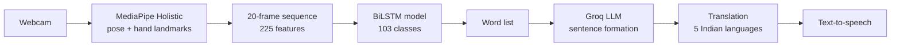

<div align="center">

# 🤟 SIGNA
### Where Signs Speak

**Real-time continuous sign language recognition and sentence formation, with translation and speech in Indian languages.**


</div>

---

## 📖 Overview

Signa bridges the communication gap between sign language users and people who don't know sign language. It reads gestures from a live webcam feed, recognizes them word by word, turns them into a meaningful sentence, and can translate and speak that sentence in **English, Kannada, Hindi, Tamil, Telugu and Malayalam**.

## ✨ Features

- **Real-time recognition** of 103 sign words using MediaPipe Holistic landmarks and a Bidirectional LSTM
- **Continuous signing**: words are collected into a running sentence
- **Smart sentence formation** using an LLM (Groq) to turn raw words into natural sentences
- **Multilingual translation** to Kannada, Hindi, Tamil, Telugu and Malayalam
- **Text-to-speech** with neural voices (edge-tts, with gTTS as fallback)
- **Live feedback** on lighting, hand detection and recording status
- **Mobile-style web app** built with React and Vite

## 🖼️ Screenshots

<div align="center">

| Start screen | Live recognition |
|:---:|:---:|
|  |  |

| Choose a language | Translated output |
|:---:|:---:|
|  |  |

</div>

## 🏗️ How It Works



1. The browser connects to the FastAPI backend over a **WebSocket**.
2. The backend captures frames and extracts pose and hand landmarks (33 pose points plus 21 points per hand, giving 225 features per frame).
3. A window of **20 frames** goes into the **BiLSTM** classifier. Predictions above a **0.70 confidence** threshold are accepted as words.
4. Recognized words are turned into a clean sentence, translated, and optionally spoken aloud.

## 🧰 Tech Stack

| Layer | Technologies |
|---|---|
| Computer Vision | OpenCV, MediaPipe Holistic |
| Deep Learning | TensorFlow / Keras, Bidirectional LSTM |
| Backend | FastAPI, WebSockets, Uvicorn |
| AI / Language | Groq API, deep-translator, edge-tts, gTTS |
| Frontend | React 18, Vite, Lucide icons |

## 📁 Project Structure

```
├── backend/              FastAPI server, trained model, translator, TTS
│   ├── main.py           WebSocket server and API endpoints
│   ├── prediction.py     Standalone recognition script
│   ├── translator.py     Multi-backend translation
│   ├── tts.py            Text-to-speech
│   ├── labels.py         The 103 gesture labels
│   └── gesture_model.h5  Trained model
├── signa-app/            React + Vite web app
├── frontend/             Simple HTML prototype
├── data/                 Landmark dataset (30 sequences per word)
├── dataset_collect.py    Collect training data from webcam
├── train.py              Train the model
├── screenshots/          App screenshots
└── requirements.txt      Python dependencies
```

## 🚀 Getting Started

### Prerequisites

- Python 3.10
- Node.js 18+
- A webcam
- A free [Groq API key](https://console.groq.com/keys)

### 1. Clone

```bash
git clone https://github.com/Dhanya-BK/Real-Time-Framework-for-Continuous-Sign-Language-Recognition-and-Sentence-Formation-.git
cd Real-Time-Framework-for-Continuous-Sign-Language-Recognition-and-Sentence-Formation-
```

### 2. Backend

```bash
pip install -r requirements.txt
cd backend
copy .env.example .env        # Linux/Mac: cp .env.example .env
```

Open `backend/.env` and add your key:

```
GROQ_API_KEY=your_groq_api_key_here
GROQ_MODEL=openai/gpt-oss-120b
```

Start the server:

```bash
uvicorn main:app --host 0.0.0.0 --port 8000
```

### 3. Frontend

```bash
cd signa-app
npm install
npm run dev
```

Open **http://localhost:5173** and allow camera access.

## 🧠 Training Your Own Model

Run these from the `backend` folder so `labels.py` is found:

```bash
python dataset_collect.py     # record gestures from the webcam into data/
python train.py               # train and save gesture_model.h5
```

## 🗣️ Supported Words

103 words across everyday categories:

| Category | Examples |
|---|---|
| Greetings | Hello, Namaste, Welcome, Goodbye, Thank you, Sorry |
| Questions | What, Where, When, Who, Why, Which, How |
| People | I, You, He, She, We, They, Friend, Family |
| Actions | Eat, Drink, Go, Come, Walk, Run, Read, Write, Help |
| Things | Water, Tea, Milk, Phone, Bag, Clothes, Money, Medicine |
| Places | Home, College, School |
| Time | Today, Tomorrow, Yesterday, Morning, Night, Now |
| Feelings | Happy, Sad, Love, Fine, Okay |

The full list is in [`backend/labels.py`](backend/labels.py).

## 🔧 Troubleshooting

- **Model won't load with a `batch_shape` error:** run `python fix_model.py` once inside `backend/`.
- **Camera not starting:** close other apps that use the webcam and refresh the page.
- **Low accuracy:** use good lighting and keep your hands fully inside the frame.

## 👥 Team

| Name | GitHub |
|---|---|
| Akshaya Shankari B | [@AkshayaShankariB](https://github.com/AkshayaShankariB) |
| Dhanya B K | [@Dhanya-BK](https://github.com/Dhanya-BK) |
| Sharanya Rai K | [@Sharanya185](https://github.com/Sharanya185) |
| Srijanya S R | [@Srijanya25](https://github.com/Srijanya25) |

---

<div align="center">

Built with ❤️ to make communication accessible for everyone.

</div>
